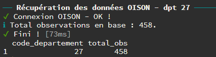
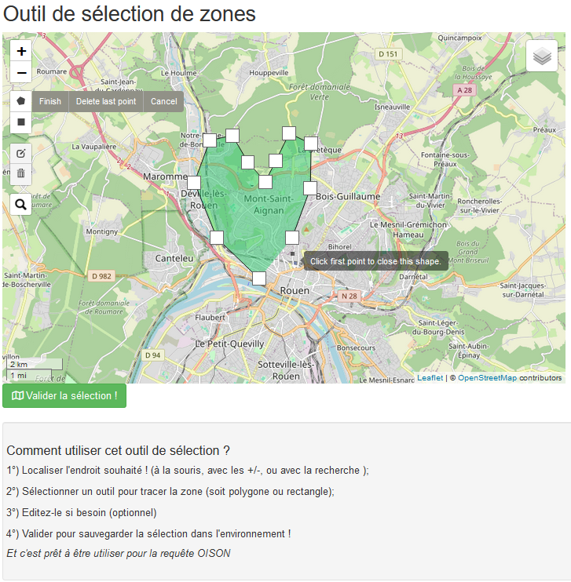

# 2. Comment utiliser le package oisonR ?

## Récupérer les données via l’accès à la base SQL

### Chargement des packages

Quelques packages sont nécessaires pour exécuter les exemples
ci-dessous.

``` r
library(oisonR)
library(sf)
library(dplyr)
# devtools::install_github("MaelTheuliere/COGiter")
library(COGiter)
```

### Les observations taxons

Les *observations taxons* de [OISON](https://oison.ofb.fr/) sont
récupérables avec la fonction
[`get_table_taxon_sql()`](https://richaben.github.io/oisonR/reference/get_table_taxon_sql.md).
Avant son utilisation, il faut toutefois :

- s’assurer de disposer des paramètres de connexion à la base SQL (*cf*.
  la vignette `oisonR` pour plus de détails) ;
- puis, initier la connexion à la base de données avec la fonction
  [`start_sql_connexion()`](https://richaben.github.io/oisonR/reference/start_sql_connexion.md).

La fonction permet de récupérer l’ensemble des observations de la base,
sauf si une géométrie est précisée en argument (argument `geometrie`
dans la fonction).

Après récupération des données, il est conseillé de stopper la connexion
à la base avec la fonction
[`stop_sql_connexion()`](https://richaben.github.io/oisonR/reference/stop_sql_connexion.md).

#### Exemple pour réaliser un export des observations taxons sur les écrevisses en Bretagne pour l’année 2023

##### 1. Création d’une géométrie pour la Bretagne

Le package `COGiter` peut être utilisé pour récupérer la géométrie
correspondant à la région, et la convertir en chaîne de caractères
utilisables pour la requête spatiale.

``` r
geom_BZH <-
  COGiter::regions_geo %>%
  # filtre sur BZH
  dplyr::filter(REG == 53) %>%
  sf::st_as_sfc() %>%
  # convert to text
  sf::st_as_text()
```

Le début de la géométrie prend la forme suivante : MULTIPOLYGON
(((286722.7 6725074, 287611.2 6724914, 288375.7 6724036, 289794 6724164,
290204.4 67246…..

##### 2. Récupération des données *observations taxons*

``` r
# a) connexion
bdd_oison <- start_sql_connexion()

# b) requete
oison_BZH <- 
  get_table_taxon_sql(conn = bdd_oison,
                      geometrie = geom_BZH)

# d) stop de la connexion
stop_sql_connexion(conn = bdd_oison)
```

Le résultat de la requête est un objet de type `data.frame`. Les noms de
colonnes peuvent être obtenus de la façon suivante :

``` r
oison_BZH %>% 
  names()
```


> ⚠️ A noter qu’ici les champs de données peuvent être différents de
> ceux présents dans les exports de l’application OISON\* (*i.e*
> \*champs manquants). Une vue simplifiée et facilement utilisable a été
> priviligée !

##### 3. Filtrage des données

Pour extraire les *observations taxons* correspondant aux écrevisses
datées de 2023, il suffit de réaliser un filtrage à partir (i) de la
colonne `nom_vernaculaire` et (ii) de la nouvelle colonne `annee` (créée
à partir de la colonne `date`) :

``` r
oison_BZH_ecrevisse_2023 <-
  oison_BZH %>% 
  # detection pattern 'creviss' et filtre
  dplyr::filter(grepl('creviss', nom_vernaculaire)) %>% 
  # création colonne annee
  dplyr::mutate(annee = format(date, '%Y')) %>% 
  # filtre sur annee 2023
  dplyr::filter(annee == 2023)
```

##### 4. Visualisation des données

Pour une réutilisation en analyse spatiale, la colonne `geometry` doit
être convertie au format `sf` (*simple features*) avec la fonction
[`st_as_sf()`](https://r-spatial.github.io/sf/reference/st_as_sf.html)
du package `sf`.

``` r
oison_BZH_ecrevisse_2023_sf <-
  oison_BZH_ecrevisse_2023 %>% 
  sf::st_as_sf()
```

Avec cet objet, les visualisations interactives sont possibles avec le
package `mapview` (*à noter qu’il ne s’agit pas des vraies données dans
l’exemple ci-dessous…* 🕶) :

``` r
oison_BZH_ecrevisse_2023_sf %>% 
  mapview::mapview()
```


##### 5. Export des données

L’export sous différents formats est possible, dont le format
*geopackage* (`.gpkg`) pour une réutilisation sous SIG.

> 💡 Le format `gpkg` permet de conserver les différents types de
> géométries pouvant se retrouver dans les observations OISON (points,
> polygones, lignes, …).

``` r
sf::write_sf(oison_BZH_ecrevisse_2023_sf, 
             "D:/oison_BZH_ecrevisse_2023.gpkg", 
             driver = "GPKG")
```

### Les observations milieu

Les *observations milieu* de [OISON](https://oison.ofb.fr/) sont
récupérables avec la fonction
[`get_table_milieu_sql()`](https://richaben.github.io/oisonR/reference/get_table_milieu_sql.md).
Comme précédemment, il faut disposer des paramètres de connexion à la
base SQL (*cf*. la vignette `oisonR` pour plus de détails).

Par défaut, la fonction permet de récupérer l’ensemble des observations
de la base, sauf si une géométrie est précisée en argument (argument
`geometrie` dans la fonction).

#### Exemple pour les observations milieu pour la région Bretagne

L’exemple ci-dessous correspond à une extraction des *observations
milieu* sur la zone géographique de la région Bretagne, en utilisant
l’objet précédemment créé (`geom_BZH` ; cf. ci-dessus) :

``` r
# a) connexion
bdd_oison <- start_sql_connexion()

# b) requete
oison_milieu_BZH <- 
  get_table_milieu_sql(conn = bdd_oison,
                      geometrie = geom_BZH)

# d) stop de la connexion
stop_sql_connexion(conn = bdd_oison)
```

Le résultat de la requête est de nouveau un objet de type `data.frame`.
Les noms de colonnes peuvent être obtenus de la façon suivante :

``` r
oison_milieu_BZH %>% 
  names()
```


## Récupérer les données via l’API

Trois fonctions permettent de récupérer les données via une “API”. Pour
le moment, il n’est possible que de récupérer les *observations taxons*.
Les fonctions sont les suivantes :

- [`get_taxon_dpt()`](https://richaben.github.io/oisonR/reference/get_taxon_dpt.md)
  pour récupérer les *observations taxons* sur un département en
  spécifiant son code insee ;
- [`get_taxon_region()`](https://richaben.github.io/oisonR/reference/get_taxon_region.md)
  pour récupérer les *observations taxons* sur une région en spécifiant
  son code insee ;
- [`get_taxon_polygon()`](https://richaben.github.io/oisonR/reference/get_taxon_polygon.md)
  pour récupérer les *observations taxons* sur une zone géographique
  définie au préalable ou tracée à la volée avec une fonction dédiée.

Avec ces 3 fonctions, il est possible de collecter les données (avec
l’argument `collect_all = TRUE`) ou simplement consulter rapidement le
nombre de données sur l’étendue géographique (lorsque l’argument
`collect_all = FALSE`).

Une période de temps peut être également spécifiée avec les arguments
`date_min` et `date_max`.

La récupération des données est séquencée pour limiter la surcharge de
l’API.

#### Exemples pour le département 27 avec `get_taxon_dpt()`

##### Consultation simple sur l’année 2022 (avec `collect_all = FALSE`)

``` r
get_taxon_dpt(
  dpt_code = "27",
  login = "john.doe@ofb.gouv.fr",
  mdp = "mon_mdp",
  date_min = '2022-01-01',
  date_max = '2022-12-31',
  collect_all = F)
```



##### Récupération des données sur l’année 2022 (avec `collect_all = TRUE`)

``` r
oison_27_df <- 
  get_taxon_dpt(
  dpt_code = "27",
  login = "john.doe@ofb.gouv.fr",
  mdp = "mon_mdp",
  date_min = '2022-01-01',
  date_max = '2022-12-31',
  collect_all = T)
```

Le résultat de la requête est de nouveau un objet de type `data.frame`.
Les noms de colonnes peuvent être obtenus de la façon suivante :

``` r
oison_27_df %>% 
  names()
```


#### Exemple avec la fonction `get_taxon_polygon()`

Cette fonction permet de consulter/récupérer (selon l’argument
`collect_all = FALSE` ou `collect_all = TRUE`) les données sur une zone
géographique définie par un polygone. Spécifier une plage de date est
également possible.

Le polygone peut :

- s’écrire manuellement sous cette forme ;

&nbsp;

    #> [1] "POLYGON ((410677.9 6877209, 413275.2 6929083, 496961.8 6925506, 495122.6 6873600, 410677.9 6877209))"

- se tracer à la volée lorsque l’argument `draw_zone = TRUE` est
  spécifié dans la fonction. Dès lors, un outil de sélection de zone
  s’ouvre (via une fenêtre interactive `shiny` ; cf. ci-dessous)
  permettant le traçage du polygone et son stockage dans l’environnement
  de travail pour la requête.

``` r
get_taxon_polygon(
  login = "john.doe@ofb.gouv.fr",
  mdp = "mon_mdp",
  draw_zone = T,
  collect_all = F)
```




